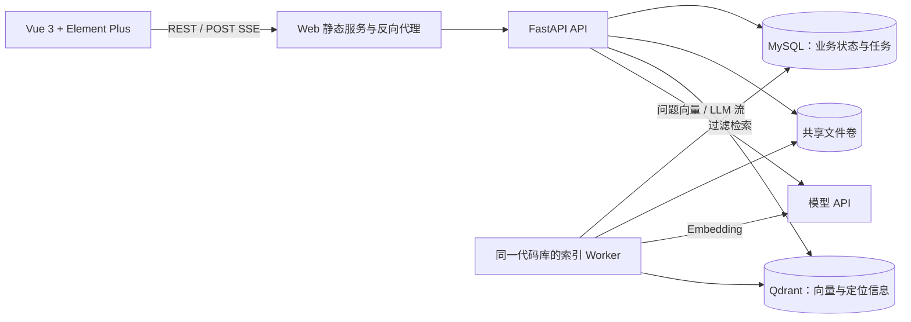

# 系统架构与实现边界

状态：阶段 4 文档/索引/安全 Dense 服务已实现，最终验收中；问答仍为阶段 5 设计。更新时间：2026-10-15。

## 1. 目标与假设

用真实上传文档完成“索引 → 权限内检索 → 流式回答 → 来源核验 → 评测”的闭环，并能解释失败恢复、数据一致性和权限边界。

默认是单机、单安装实例、多用户、多知识库场景。MVP 每次问答只选一个知识库；文档继承知识库权限。先面向数十名用户、小规模文档演示，不承诺高可用或生产 SLA。MVP 默认单知识库最多 200 个未删除文档，用于限制版本过滤及本地资源开销；扩大规模时先压测并改进检索范围构造。

本地部署应用、MySQL、Qdrant 和文件存储，LLM/Embedding 通过真实供应商 API 调用。供应商及模型在 AI 接入阶段依据实际可用凭据确定；不能假设所有兼容网关具有相同流式、token 或 Embedding 语义。

## 2. 运行结构



Compose 最终包含 `web`、`api`、`worker`、`migrate`、`mysql`、`qdrant`。`migrate` 是一次性迁移任务，API/Worker 等迁移成功再启动。第二阶段只创建当时必要的服务，Worker 到索引阶段才加入。

阶段 2 另有仅显式启用的 test profile，用于独立项目的真实服务集成测试。API 与 migrate 共用代码及 Dockerfile runtime 阶段，使用不同本地镜像标签，避免 Compose 并行导出相同标签发生竞争。Web 默认仅绑定 loopback；`compose.dev.yaml` 显式开放本机开发所需的数据端口。

- API 与 Worker 共用 Python 包、数据库迁移及配置，有不同入口和生命周期。
- MySQL 是用户、权限、文档、任务、有效索引版本和会话的唯一业务事实来源。
- Qdrant 是派生索引，可以从原文件、索引配置和业务记录重建。
- 原文件通过本地共享卷保存，API 写入、Worker 读取；路径不直接暴露给客户端。
- Web 代理 `/api`，让 UI 与 API 同源；Vite 开发时也配置代理。SSE 关闭代理缓冲。
- 不增加 Redis/Celery/Kafka、Elasticsearch、Agent 框架或独立权限服务。任务吞吐达到瓶颈后再用数据证明是否迁移队列。

## 3. 模块职责

| 模块 | 负责 | 边界 |
| --- | --- | --- |
| `identity` | 登录、用户状态、凭据校验 | JWT 只载用户身份，不缓存知识库权限 |
| `knowledge_bases` | 知识库及成员角色、访问范围 | 所有业务入口复用同一权限服务 |
| `documents` | 上传、元数据、文件读取、逻辑删除 | 不在 HTTP 请求中执行完整索引 |
| `indexing` | 解析、切分、Embedding、索引版本发布 | 任务状态机、租约及幂等规则由此维护 |
| `retrieval` | 安全范围构造、Top-K、Filter、后续 Hybrid/Rerank | 所有召回分支接受已鉴权的范围对象 |
| `chat` | 会话、历史裁剪、提示、流式输出、引用 | 对话历史存 MySQL，不依赖进程内 Memory |
| `evaluation` | 离线评测入口、指标及可复现实验 | 调用与在线问答相同的检索服务 |
| `core` / `infrastructure` | 配置、日志、错误、DB/Qdrant/模型/文件适配 | 不承载权限和索引发布等业务决策 |

依赖方向：路由与 Worker 入口 → 应用服务 → 领域规则/接口 → 外部适配实现。采用具体清晰的服务和仓储，不为每张表机械创建抽象工厂。

目录（健康、身份、知识库、文档、索引、Dense 检索与基础设施已实现；问答后续添加）：

```text
backend/
  app/
    api/                 # 路由、鉴权依赖、请求响应模型
    modules/             # identity、documents、indexing、retrieval、chat 等
    core/                # 配置、错误、日志
    infrastructure/      # SQLAlchemy、Qdrant、模型和文件适配
    worker.py            # 索引/清理任务入口
    main.py              # FastAPI 入口
  migrations/
  tests/                 # unit、integration、live
frontend/
  src/                   # views、components、api、composables、types
evaluation/              # 获授权语料的题集与标注；输出不提交
deploy/                  # Dockerfile、代理配置
docs/
compose.yaml
```

## 4. 文档索引流程

1. 验证身份、知识库写权限、配额、文件大小及类型。MVP 支持 UTF-8 TXT/Markdown、包含可提取文字的 PDF；不做 OCR、DOCX、网页抓取或压缩包解包。
2. 流式写入临时文件，计算 SHA-256，使用服务端 UUID 文件名并原子移动至正式路径；数据库事务同时创建文档和索引任务。事务失败时删除本次文件，定期清理无业务记录的孤立文件。
3. Worker 在短事务内用 `FOR UPDATE SKIP LOCKED` 领取任务，更新次数、租约和随机 `lease_token`，创建本次独立索引版本后提交。解析和模型调用均在事务外执行。
4. 分页/分段解析，保留 PDF 页码、标题或字符位置。按递归分隔符切分，中文加入句号、逗号等；初始默认 800 字符、目标重叠 120 字符，可配置且随版本记录。Overlap 是目标值，不能保证每块恰好重叠 120 字符。
5. Chunk 文本与定位信息存 MySQL；Embedding 批量调用，校验向量数量、维度、有限数值及模型一致性。每个点使用确定性 UUID，批次 upsert 等待 Qdrant 确认。
6. 全部 Chunk 和点写入成功后，在短事务内检查租约、文档未删除、任务仍为该文档的当前任务，原子更新 `active_index_version_id`、版本状态和任务完成状态。
7. 后台清理失败、过期和被替换的版本；清理失败不回滚已发布版本，记录可重试清理任务。磁盘、解析页数、提取字符数及 Chunk 数都有上限。

默认保护性上限：单文件 10 MiB、PDF 100 页、提取文本 200 万字符、每次索引 5,000 个 Chunk；限值都需明确报错，不能静默截断后显示“成功”。PDF 无可提取正文时返回 `DOCUMENT_TEXT_EMPTY` 并说明不支持 OCR。

### 4.1 任务恢复与跨存储一致性

- 投递语义是 **at-least-once**，不是 exactly-once；重复执行必须安全。
- 初始只跑一个 Worker，但领取和发布逻辑按多 Worker 竞争设计并测试。
- 租约默认 90 秒，每 20 秒续租；解析放受限子进程以便超时终止，同时主 Worker 能续租。
- 任务默认最多自动执行 3 次；仅瞬时网络错误、429、可重试 5xx 等进入指数退避，永久格式/凭据/维度错误直接失败。
- 租约过期由巡检重新排队；每次领取生成新的索引版本与 lease token。旧 Worker 即使迟到写入，也只写旧版本，且无法通过发布条件。巡检将遗留 staging 标失败并重复清理孤立向量，避免清理后迟到写入永久堆积。
- 手动重试仅对终态失败任务有效，创建关联的新任务，保留失败历史；同一失败任务最多创建一个直接后继，失败后再重试后继任务。索引重试通过文档行锁竞争，清理重试通过原任务行锁竞争。
- MySQL 与 Qdrant 没有共享事务。只有 MySQL 指向的完整版本才可检索，避免写了一半的数据进入模型上下文。
- 重建失败保留原有效版本，UI 同时展示“仍可检索”和“最新任务失败”；不把任务状态等同于检索可用性。
- 同一文档只允许一个当前索引任务；MVP 不实现文件覆盖更新，修改正文通过新上传处理，重建仅重新处理原文件。
- 删除先在 MySQL 逻辑删除并清空有效版本、撤销任务发布资格，再提交清理任务。Qdrant 或文件删除失败时数据仍不可检索，物理清理可重试。
- 巡检检测到有效版本点缺失时标为不可用并安排修复；不自动放宽过滤或谎报数据完整。

MySQL 队列的依据及使用限制见[官方锁定读文档](https://dev.mysql.com/doc/refman/8.4/en/innodb-locking-reads.html)。这里只借用领取机制，租约和版本发布属于本项目业务设计。

## 5. 权限与检索边界

MVP 角色为 `owner`、`editor`、`viewer`。创建者自动成为 owner；至少保留一个有效 owner。owner 管成员及知识库，editor 管文档，viewer 只读及问答。实例管理员负责用户生命周期，不自动获得所有知识库读取权。

登录使用短期 Bearer JWT（默认 30 分钟）和 Argon2 密码哈希；前端内存保存 token，刷新页面重新登录，MVP 不做 refresh token。每次业务请求检查用户有效状态和当前成员记录，不把历史 JWT 中的角色当作授权依据。用户通过管理 CLI 创建，MVP 不开放公开注册。

阶段 3 为跨库用户停用与成员变更引入 authorization_guard 单行 MySQL 锁；所有授权写操作先锁 guard，再锁库及检查最新有效 owner。路由鉴权后，写服务在取得锁后再次校验身份/角色；普通读取使用短 READ COMMITTED 事务。密码哈希不占用事务。此方案接受小规模写操作串行化，避免复杂跨库锁顺序带来的遗漏；不是全局外部服务锁或新队列。

检索按以下顺序实施，失败一律停止：

1. 验证用户与会话归属，验证指定知识库成员关系。
2. 从 MySQL 取得该知识库未删除文档的有效版本；客户端 `document_ids` 等条件只能缩小范围，不能提供任意 Qdrant Filter。
3. 构造强制 `kb_id = 当前知识库 AND index_version_id IN 有效版本集合`；空集合直接返回无上下文，不发无过滤查询。每个 dense、sparse、prefetch 分支必须带同一范围。
4. Qdrant 只返回定位 payload；按返回 ID 从 MySQL 加载正文，批量复核文档归属、删除状态、有效版本和成员关系，再交给 Rerank/LLM。正文不会在复核前发送给外部服务。
5. 若并发删除/重建导致候选失效，丢弃候选，最多进行两轮有限补召回；不足 Top-K 可以诚实返回较少来源。
6. 文档详情、原文件、Chunk、任务、历史消息和引用接口也做同样资源归属检查。禁止仅在前端隐藏按钮或召回后删除越权答案。

授权以请求开始、构造模型上下文及输出检查的当前数据库状态为准。流式期间定期（最多 1 秒间隔）复核成员关系，撤权后终止后续输出；已在合法授权时发给供应商或浏览器的内容无法追回。MVP 不承诺跨数据库与外部 API 的全局瞬时撤权事务。

单个知识库共享一个 Embedding profile；同 profile 的知识库可以共享 collection 并通过过滤隔离。collection 由模型标识、维度、距离和 profile 版本确定，不能把不同 Embedding 空间混在一起。建库可暂未绑定 profile，首次索引前必须完成真实验证和原子绑定，此后 MVP 不允许更换；整库模型迁移留到后续。

Qdrant payload filter 是应用隔离机制，不是 Qdrant 原生用户 ACL；Qdrant 不向浏览器开放。[官方过滤说明](https://qdrant.tech/documentation/search/filtering/)

## 6. 问答与 SSE

问答路径：身份与会话检查 → 历史裁剪 → 独立检索问题 → 问题 Embedding → 受限召回 → 正文复核 → 上下文预算 → Prompt → LLM 流 → 引用验证与消息落库。

- 会话固定知识库并归一个用户，不能由客户端传任意 user_id 或替换会话知识库。
- 多轮默认最多使用最近 6 个完整轮次，依据模型 token 上限裁剪；失败/取消的助手消息不进入历史。若历史助手消息引用的文档已删除或索引版本失效，该助手消息不进入新一轮上下文。
- 追问存在历史时先用真实 LLM 改写为独立检索问题。改写失败明确记录并可用原问题继续检索；日志记录是否发生该降级。
- token 计量交给供应商适配器的可靠 tokenizer/计数能力，不能把中文字符数当 token；输入总量为系统提示、历史、问题、来源及预留输出之和。
- 引用候选由服务端编号，例如 `[S1]`，附 Chunk 和文档定位。候选来源与最终使用的引用区分；仅接受本轮已授权候选中的引用编号。
- 正文需带有效引用的回答若缺少引用，或输出未知引用编号，最终校验失败，发送 `CITATION_INVALID` 并保存失败状态；流中的草稿不能因此标记成功。无证据拒答不要求引用。
- 无上下文时返回明确的“知识库中未找到足够依据”，不调用模型编造文档结论；有上下文仍可能缺乏答案，Prompt 要求说明证据不足。
- 文档片段与用户输入均是非可信内容，通过明确分隔及提示说明只作为事实材料；MVP 不给模型执行工具或读取额外库的权限。Prompt 约束不能替代服务端权限隔离。
- 引用编号可验证不等于回答事实完全正确；引用相关性与事实支持由评测处理。流中正文暂为草稿，最终引用列表在完成事件中确认。
- 后端使用当前 FastAPI 官方 SSE 功能；前端用 `fetch` POST 携带 Bearer token，消费流式 body、增量 UTF-8 解码并按事件边界解析。断开用 AbortController。
- 同一会话至多一个生成中的助手消息，避免历史交叉；请求 ID 防止重复点击生成两次。
- 客户端断开时取消模型调用并保存 `cancelled` 与已生成内容；API 崩溃后通过超时巡检将遗留 `generating` 标为 `interrupted`。这些内容不会作为成功答案进入历史。
- 只在完成消息及引用事务提交后发送 `done`；落库失败时发送错误并保留未完成状态，不能展示已成功保存。
- 不提供自动续传或自动重放 POST；网络断开后通过消息详情核验状态，重试是显式的新请求。
- Markdown 禁止原始 HTML，并清理危险链接；来源打开时重新鉴权。

SSE 使用依据见 [FastAPI SSE](https://fastapi.tiangolo.com/tutorial/server-sent-events/)、[Fetch 流处理](https://developer.mozilla.org/en-US/docs/Web/API/Fetch_API/Using_Fetch)。事件契约见 [api-contract.md](api-contract.md)。

## 7. MVP 与后续边界

| 能力 | MVP：阶段 2–5 | 后续：阶段 6 及以后 |
| --- | --- | --- |
| 身份/权限 | 登录、用户停用、知识库成员角色、文档继承权限 | 企业 SSO、组织租户、文档级 ACL |
| 文档 | TXT/MD/文字 PDF，元数据、逻辑删除、物理清理 | OCR、DOCX、连接器、文件版本管理 |
| 索引 | 真实解析/切分/Embedding/Qdrant，持久化任务、重试、重建 | 批量同步、增量更新、整库模型迁移 |
| 检索 | Dense Top-K、有效版本过滤、文档/类型/标签 Filter | Dense + sparse Hybrid、RRF、真实 Rerank |
| 问答 | 单库多轮、SSE、Markdown、来源与拒答 | 跨库检索、复杂 query rewrite 策略 |
| 评测 | 小型真实语料评测、检索/引用/拒答及耗时基线 | 对比实验、LLM-as-judge、较大 benchmark |
| 运维 | Compose、结构化日志、超时、健康检查、pytest | HA、分布式队列、完整监控平台 |

Top-K 默认 5，允许 1–20；可选 score threshold 必须明确对应模型/profile，不能把余弦分数称为置信度。预留 Retriever/Reranker 接口，不在 MVP 暴露未实现的 Hybrid/Rerank 开关；请求未支持策略返回错误。

后续 Hybrid 必须真实生成 sparse 表示并处理中文分词、词表/统计版本，再用 RRF 融合。Rerank 使用真实模型或服务，限制候选量与超时；若允许降级必须在响应/评测记录中声明。是否默认启用由同一标注题集的质量与耗时对比决定。[Qdrant Hybrid Queries](https://qdrant.tech/documentation/search/hybrid-queries/)

## 8. 可靠性与部署原则

- 结构化日志携带 request_id、job_id、kb_id、阶段及耗时，不记录密码、token、正文或完整 Prompt。索引失败码可见，堆栈限后端日志且脱敏。
- 初始默认：Qdrant 5 秒、单次 Embedding 30 秒、改写 20 秒、LLM 首 token 30 秒/空闲 30 秒/总生成 120 秒、单个索引任务 15 分钟。全部可配置，后续通过真实调用校准。
- 非流式临时外部错误最多重试 2 次，并受总 deadline 约束；首次 token 输出之后不自动重启生成，避免重复答案。
- API 保持异步 IO；解析 CPU 工作进入 Worker 受限子进程，限制并发和文件资源。不给每个 SSE 流长期占用数据库连接。
- `/health/live` 不依赖外部服务；`/health/ready` 检查 MySQL、Qdrant 与迁移状态。模型配置缺失单独显示能力不可用，健康检查不消耗模型额度。
- 阶段 2 通过 SQLAlchemy asyncmy 和带密钥的 HTTP 探测实现健康检查；阶段 4 选择继续使用 HTTPX REST 适配器，理由见实施决定。连接池和 HTTP client 由 FastAPI lifespan 管理；探测失败只记录安全状态，不记录原始异常。AUTH_SECRET 自阶段 3 起必填；当前已实现身份与文档接口。
- MySQL/Qdrant 使用命名卷，文件使用独立卷；只有 Web 默认暴露到本机 loopback，开发 profile 才额外开放所需端口。
- MySQL root 仅用于初始化，应用使用独立账号；Qdrant 开启 API key。密钥只供服务端，版本镜像固定且数据迁移由单独任务执行。
- 首版给出数据持久化、备份和恢复说明；本地单副本方案可恢复，但不等于生产高可用。

这些边界是本项目设计决策；发布版本和环境事实见 [environment-and-dependencies.md](environment-and-dependencies.md)，阶段验收见 [development-plan.md](development-plan.md)。

## 阶段 4 实施决定（2026-10-15）

用户已选择硅基流动免费 `BAAI/bge-m3` 云端服务，凭据为 `SILICONFLOW_API_KEY`；实际探测 HTTP 200、1024 维。模型标识固定为非 Pro 版；供应商不提供不可变权重修订号，profile 如实记录 `provider-managed`，不能承诺识别同维度的供应商权重变更。

Qdrant 延用 HTTPX 适配器直接调用已核对的 1.19 REST API，避免再加入同步/异步 SDK 与重复连接池。命名向量 dense、等待写确认和强制过滤规则不变。token 计数使用 BAAI 官方固定 revision 的 tokenizer.json 和 tokenizers，不下载模型权重；tokenizer 文件随镜像构建并核验 SHA-256，不在请求路径下载。

文件额外限制：每库未删除文件累计 500 MiB；文件卷使用量达到 2 GiB 时拒绝新上传。正文只在 MySQL、文件卷和获授权模型请求中出现，不写 Qdrant payload 或日志。multipart 总请求体限制为 11 MiB，文件本身上限 10 MiB；临时文件失败即删，超过一天的无业务记录文件由巡检清理。API/Worker 共享文件卷，并行外部操作不持数据库事务。

清理任务只清理已经失效的版本或已删除文档；为防迟到 Worker 在清理后写入，周期巡检重复删除所有 failed/retired 版本向量（幂等），MySQL 保留版本与任务历史。阶段 4 尚无引用表，可清理失效 Chunk；阶段 5 加引用后需扩展保留策略。有效版本点缺失时清除有效指针并创建修复任务，不能继续标记可检索。

阶段 4 空库删除要求所有已删除文档 purged_at 非空，避免清理失败后先删父库造成无法授权重试、文件永久残留。上传落盘按单 API 进程串行配额检查；当前仍只部署一个 API 进程，扩展多 API 写入前需引入跨进程存储配额预留。
