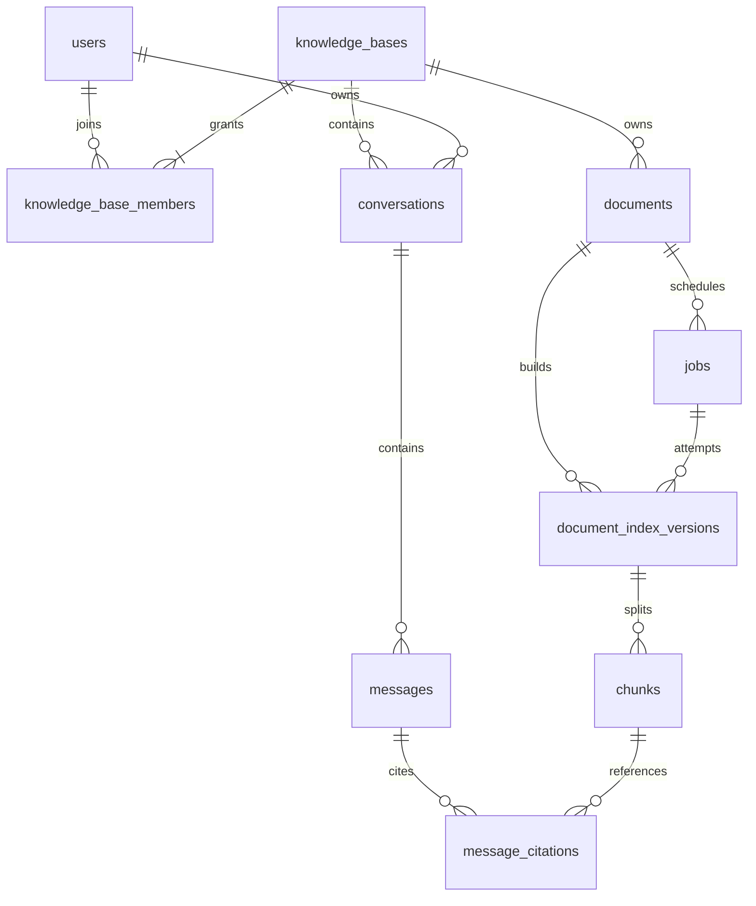

# 核心数据模型

> 本提交为补录的设计基线，根据最早保存的阶段2设计资料回溯整理，并非阶段1精确原始快照。

本文件为逻辑/物理设计基线，不是已执行的 SQL。表随阶段通过 Alembic 增量创建；不在第一轮迁移一次建齐全部表。

## 1. 通用约定

- MySQL 8.4、InnoDB、utf8mb4；事务边界由服务层显式控制。
- 实体 ID 使用应用生成 UUID，数据库初版 `CHAR(36)` ASCII；API、Qdrant payload 均使用 UUID 字符串。优先可读和联调，实测后才考虑 BINARY(16)。
- 时间使用 UTC `DATETIME(6)`，API 输出 ISO 8601 `Z`；业务判断和租约统一使用数据库时钟。
- 状态和角色使用有长度限制的字符串、Pydantic/domain 枚举及数据库 CHECK；外键约束、唯一键不能仅靠应用判断。
- JSON 用于不可变配置快照或扩展信息，权限、状态和高频过滤字段保留为普通列。
- 关联表外键默认 RESTRICT，重要记录不做级联硬删；物理清理由任务按生命周期执行。
- 文档/知识库逻辑删除后，成员、会话、引用接口仍必须核验父资源状态。

## 2. 关系图

## 3. 核心表

### users（阶段 3）

| 字段 | 类型/约束 | 含义 |
| --- | --- | --- |
| id | PK UUID | 用户身份 |
| username | VARCHAR(64)，UNIQUE | 登录标识，服务端统一规范化 |
| password_hash | VARCHAR(255)，NOT NULL | Argon2 哈希，禁止存密码 |
| is_active | BOOLEAN，NOT NULL | 停用后所有新请求拒绝 |
| is_admin | BOOLEAN，NOT NULL | 允许管理用户，不能绕过知识库读权限 |
| created_at / updated_at | DATETIME(6) | 时间 |

用户创建由管理 CLI 完成，不提交默认账号或明文密码。

### knowledge_bases（阶段 3）

字段：`id` PK、`name VARCHAR(120)`、`description TEXT`、`created_by` FK users、`embedding_profile_id VARCHAR(64) NULL`、`embedding_profile JSON NULL`、`deleted_at`、创建/更新时间。

`embedding_profile` 包括供应商、模型标识/修订、向量维度、距离、预处理版本、collection 名。配置不含密钥；阶段 3 可暂未绑定，首次索引前在事务外探测真实模型，再锁知识库行校验并原子绑定，此后不可任意替换。两个 profile 字段必须同时为空或同时有效；既有知识库启动时校验配置漂移。创建者只记录来源，权限由成员表决定。

索引：`(created_by, deleted_at, created_at)`。同名知识库允许存在，以 ID 区分。

### knowledge_base_members（阶段 3）

字段：`kb_id` FK、`user_id` FK、`role VARCHAR(16)`（owner/editor/viewer）、创建/更新时间。复合主键 `(kb_id, user_id)`；反向索引 `(user_id, kb_id)`。

建库与创建 owner 成员同一事务。增删/降级 owner 时锁定知识库行，并验证剩余有效 owner；用户停用也检查其拥有知识库的有效 owner 数，防止并发操作留下无人管理的库。

### documents（阶段 4）

| 字段 | 类型/约束 | 含义 |
| --- | --- | --- |
| id / kb_id / uploaded_by | PK / FK / FK | 归属 |
| filename / media_type | VARCHAR(255) / VARCHAR(100) | 原名称与确认的格式 |
| storage_key | VARCHAR(255)，UNIQUE | 服务端内部路径标识 |
| content_sha256 / size_bytes | CHAR(64) / BIGINT | 原文件哈希与大小 |
| tags | JSON 数组 | 受限标签，后端校验 |
| active_index_version_id | 可空 FK versions | 当前可检索的完整版本 |
| current_job_id | 可空 FK jobs | 当前索引任务，串行化重建/重试 |
| deleted_at | 可空 DATETIME(6) | 逻辑删除后立即不可检索 |
| created_at / updated_at | DATETIME(6) | 时间 |

索引：`(kb_id, deleted_at, created_at)`、`(kb_id, content_sha256)`。哈希仅用于识别，不在 MVP 自动去重；相同字节的两次显式上传可以是两个文档，响应诚实说明。上传、重建和删除操作锁定知识库/文档必要行，执行文档配额及当前任务检查。

`availability` 是 API 派生字段：未删除且存在完整有效版本时为 `searchable`，否则 `unavailable`；`latest_job_status` 独立展示。避免重复保存两个可能漂移的状态。

### jobs（阶段 4）

| 字段 | 类型/约束 | 含义 |
| --- | --- | --- |
| id / kb_id / document_id | PK / FK / FK | 任务归属 |
| kind | VARCHAR(16) | index / purge |
| status | VARCHAR(20) | queued / running / retry_wait / succeeded / failed / cancelled |
| stage | VARCHAR(24) | parse / chunk / embed / upsert / publish / cleanup |
| attempt_count / max_attempts | INT | 默认最多 3 次自动执行 |
| progress_completed / progress_total | INT / 可空 INT | 当前阶段进度，未知总量不能伪造百分比 |
| available_at | DATETIME(6) | 初次或退避后的领取时刻 |
| lease_owner / lease_token | VARCHAR(100) / 可空 UUID | Worker 和本次领取凭证 |
| lease_expires_at / heartbeat_at | 可空 DATETIME(6) | 崩溃恢复 |
| retry_of_job_id | 可空 FK jobs | 手动重试历史 |
| target_config | JSON | 索引 profile、parser/splitter 配置或清理范围 |
| error_code / error_message | VARCHAR(64) / VARCHAR(1000) | 脱敏错误，不存完整堆栈 |
| started_at / finished_at | 可空 DATETIME(6) | 运行时间 |
| created_at / updated_at | DATETIME(6) | 时间 |

索引：`(status, available_at, id)`、`(status, lease_expires_at)`、`(document_id, created_at)`、`(kb_id, created_at)`；`retry_of_job_id` UNIQUE（允许多个 NULL），保证同一失败任务最多一个直接重试后继。

状态转移：`queued → running → succeeded`；可重试错误 `running → retry_wait → running`；永久错误/次数耗尽进入 `failed`；删除或失去发布资格进入 `cancelled`。过期 running 在次数允许时重排，否则 failed。终态不直接改回 queued，手动重试创建新任务；后继再次失败时重试后继，不重复重试祖先。

领取及续租使用条件更新，发布条件包含当前 lease token、未过期租约、`documents.current_job_id` 和未删除标记。每次 attempt 对应新的 index version，避免迟到写覆盖新结果。

### document_index_versions（阶段 4）

字段：`id` PK、`document_id/kb_id/job_id` FK、`attempt_no INT`、`status VARCHAR(16)`（staging/published/retired/failed）、`embedding_profile_id`、`collection_name`、`config_snapshot JSON`、`chunk_count INT`、`source_sha256`、`error_code`、`created_at/published_at`。

唯一键 `(job_id, attempt_no)`；索引 `(document_id, status)`、`(kb_id, status)`。

一次发布事务把该版本设 published、原有效版本设 retired，并切换文档指针。只有指针引用且 profile 匹配的版本可作为检索范围，不能只看 published 字符串。失败版本不影响旧版本；retired 版本按引用保留策略清理。

### chunks（阶段 4）

字段：`id` PK UUID、`kb_id/document_id/index_version_id` FK、`ordinal INT`、`text MEDIUMTEXT`、`text_sha256 CHAR(64)`、`page_no INT NULL`、`section_title VARCHAR(255) NULL`、`char_start/char_end INT NULL`、`token_count INT NULL`、`metadata JSON`、`created_at`。

唯一键 `(index_version_id, ordinal)`；索引 `(kb_id, document_id, index_version_id)`。`id` 用 UUIDv5 从索引版本和 ordinal 派生，并作为 Qdrant point ID。页码对外从 1 起；字符区间采用解析片段内 Unicode 字符的 `[start, end)`，不能伪装成原文件字节偏移。Chunk 先按页/解析段切分，定位保持可核验。

冗余 kb_id/document_id 用于高频校验；通过复合唯一键及复合外键保证版本、文档、知识库一致，不允许 Chunk 指向另一个库的版本。

### conversations（阶段 5）

字段：`id` PK、`user_id/kb_id` FK、`title VARCHAR(120)`、`next_sequence_no INT`、`active_message_id` 可空 FK messages、`created_at/updated_at`。

索引 `(user_id, updated_at)`。会话只归单个用户且绑定单个知识库；创建后不更换 kb_id。创建新请求时锁会话行，分配消息序号和 active_message_id，避免两个并发生成混用历史。

### messages（阶段 5）

字段：`id` PK、`conversation_id` FK、`sequence_no INT`、`role VARCHAR(16)`（user/assistant）、`status VARCHAR(20)`（completed/generating/failed/cancelled/interrupted）、`content MEDIUMTEXT`、`client_request_id` 可空 UUID、`reply_to_message_id` 可空 FK、`retrieval_query TEXT NULL`、`retrieval_config JSON NULL`、`model_config JSON NULL`、`usage JSON NULL`、`timings JSON NULL`、`error_code`、`generation_deadline_at/heartbeat_at`、创建/完成时间。

唯一键 `(conversation_id, sequence_no)`、`(conversation_id, client_request_id)`；只有 user 消息填写 client_request_id，assistant 设 NULL，避免同请求两条消息冲突。一个事务插入用户消息、generating 助手消息并占用会话生成槽。结束事务保存状态、引用并释放槽；巡检处理崩溃遗留槽。

日志不保存全文，但业务会话需要持久化正文；其读取严格受会话归属及当前知识库权限控制。usage 仅记录供应商实际返回的数据，未返回时为 NULL，不能估造计费 token 数。

### message_citations（阶段 5）

字段：`id` PK、`message_id` FK、`source_label VARCHAR(16)`、`document_id/index_version_id/chunk_id` FK、`locator_snapshot JSON`、`retrieval_score DOUBLE NULL`、`rerank_score DOUBLE NULL`、`created_at`。

唯一键 `(message_id, source_label)`；索引 `(chunk_id)`。只存经过验证的最终引用；label 只在本消息内有效。定位快照包含文件名、页码/标题和有限信息，不包含越权绕过链接。

文档删除后来源返回不可用，不能靠快照返回已删除正文。被引用的旧 Chunk 可保留用于内部追溯，但不能用于新检索；普通退休版本无引用时可以清理。历史回答是曾经合法生成的业务记录，不承诺文档删除自动擦除历史回答；读会话仍要求当前知识库权限，未来若有合规擦除需求需单独定义保留策略。

## 4. 跨表约束及迁移顺序

`documents ↔ jobs/versions`、`conversations ↔ messages` 存在循环关联。迁移先创建主表和子表，再增加可空指针外键；插入时先主记录，再任务/版本或消息，最后设置指针，同一事务完成。

除单列 FK 外，使用必要的 `(id, kb_id)`、`(id, document_id, kb_id)` UNIQUE 与复合 FK，约束跨库关联。有效版本、当前任务及会话 active_message 必须属于同一父资源；生命周期条件由锁定事务验证，并以集成测试覆盖，不能仅依靠 FK。

服务层原子保证：一个文档一个当前索引任务、一个会话一个生成槽、至少一个有效 owner。MySQL 不使用 PostgreSQL 式部分唯一索引；采用父行锁与指针作为并发约束。

## 5. Qdrant 设计

- 按 Embedding profile 创建 collection，dense 命名向量 `dense`，默认 Cosine；维度以真实 Embedding 探测结果为准，不预写 1536/1024 等假设值。
- point ID 等于 Chunk UUID；向量对应该版本 Chunk 文本。
- payload：`kb_id`、`document_id`、`index_version_id`、`chunk_id`、`embedding_profile_id`、`file_type`、`tags`、`document_created_at`、`page_no`。
- 不在 payload 保存完整正文；返回后从 MySQL 经复核读取，减少重复数据与越权外发路径。
- 导入前建立 kb_id、index_version_id、document_id、file_type、tags 的 keyword payload index。document_created_at 初版仅记录；开放时间筛选时再增加 datetime index，字段类型须与 filter 一致。
- 强制过滤字段来自服务端，用户筛选只是附加条件；tags 修改与新的 index 重建任务在同一 MySQL 事务提交，返回状态明确。MVP 用重建同步元数据，过滤候选仍在 MySQL 复核，防止同步窗口返回不匹配结果。
- MVP 文档元数据修改限名称/标签；标签同步未完成时检索可少召回但不能返回不满足当前条件的候选。
- Hybrid 阶段才增加 `sparse` named vector、稀疏模型与词表/分词版本；新字段及旧文档补索引有独立迁移计划。

## 6. 评测数据

MVP 使用版本化 JSONL 题集和单次运行的 JSON/Markdown 报告，不新增评测管理业务表。题集只包含获授权、可公开提交的真实语料定位与人工标注；运行报告、临时 UUID 映射和私有语料默认不提交。

题集以文件 SHA-256、页码/标题、证据片段定位，不依赖每次重建变化的 Chunk UUID。执行时解析为本次真实数据库资源并记录配置、模型、索引版本和题集哈希。未来需要评测管理 UI 时再增加 evaluation_runs/results 表。
