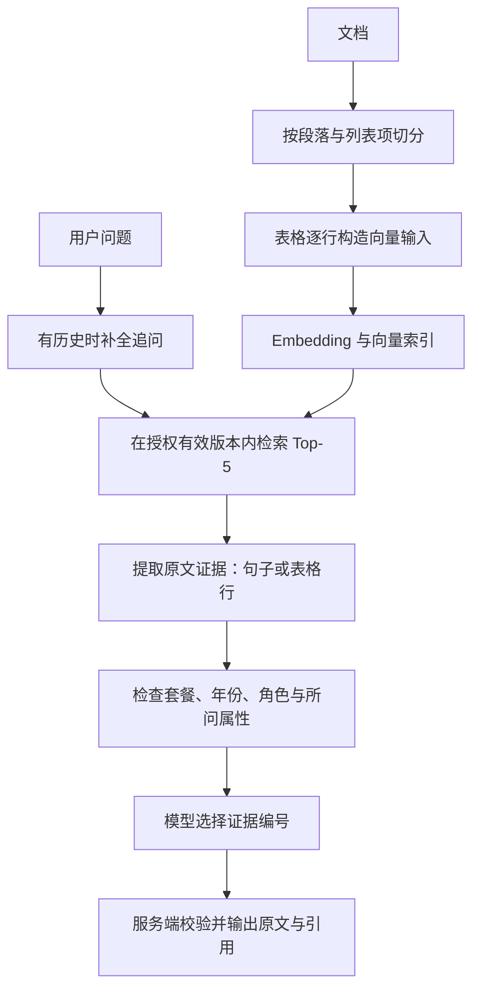
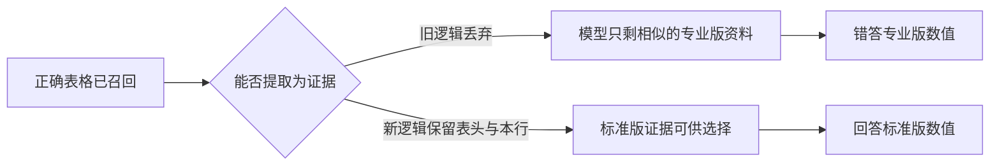
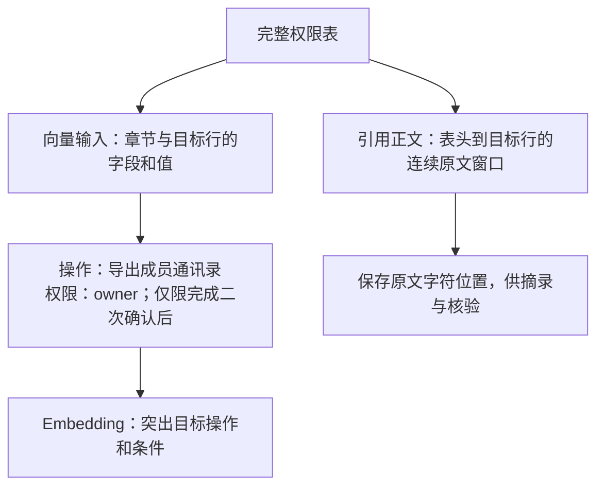

# RAG 答案优化：先看懂问题，再看代码

核对日期：2026-10-16。本文只整理当前已实现的优化；面试时可直接使用[精简口述版](interview-rag-optimization-pitch.md)。

## 1. 先分清：究竟是哪一环出错？

RAG 先从文章里找资料，再用资料回答。**找到了相关资料，不代表找到了答案；找到了答案，也可能在后续处理时丢掉或用错。**

这里的 Chunk 是文章切片；Embedding 是把文字转换成用于相似度检索的向量；Top-5 是最终返回给问答流程的前五个候选切片。



向量查询附带服务端权限和有效版本过滤；返回正文前还会用 MySQL 复核。**提高召回不能靠放宽权限。** 实现在 [retrieval/service.py](../backend/app/modules/retrieval/service.py#L76)。

先记住这张问题表，再看下面的代码：

| 具体问题 | 错在哪里 | 实际做了什么 |
| --- | --- | --- |
| 文档数量上限的依据排第9；切分参数在前20仍未命中 | 切片混合多个主题，正确事实不够突出 | 按段落、列表项切分；标题和首段保持在一起 |
| 先问“系统如何做文档切分？”，再问“默认块长度和重叠呢？” | 追问缺少主题，改写也可能漏掉对象或其中一个要求 | 补全对象、领域、动作和全部要求，形成一个独立问题 |
| 标准版 CSV 应答12,000行、18小时，却答专业版120,000行、4小时 | 正确表格已在第1名，但证据提取代码把它丢了 | 支持普通表格，绑定表头与本行；排除套餐、年份、格式冲突 |
| 问 owner 导出通讯录的条件，却答 viewer 不得导出 | 正确行排第7，模型又选了其他角色的资料 | 表格逐行向量表示，把正确行提升到第2；缺少条件时拒答 |
| 问合同签署日期，却答文档交付日期；问地点，却答日期 | 同主题资料被误当成所问事件或属性的答案 | 约束事件和属性；模型只选证据，服务端输出原文 |
| 问文件累计容量，却答200份文档 | 数量与容量混淆 | 容量证据检查单位；同时问每库和文件卷时检查两部分覆盖 |
| 行索引改好后，同一表格行重复展示 | 不同切片的原文窗口有重叠 | 按文档、有效版本、页码和原文区间去重 |

## 2. 找不到依据：先把切片和问题表达做好

### 切片：让一个向量尽量表达一个主题

旧切片可能把“文档数量、容量、索引租约”等内容放在一起。相似度检索面对的是整个切片，目标事实容易被其他内容稀释。

现在先按段落、列表项分开，再对过长内容递归切分；标题与紧随的首段不拆开，避免日期或数字失去所属对象。默认仍是 **800字符、目标重叠120字符**，不是简单把块调得更大。

真实代码摘录：[parser.py:59](../backend/app/modules/indexing/parser.py#L59)。

```python
ranges = (
    paragraph_ranges(text, headings) if structure == "paragraph-v2" else [(0, len(text))]
)
```

理解方式：原来可能是一个“数量＋容量＋租约”的大块，现在先成为各自的段落或列表项；各块仍保留原文位置。仅增加标题输入、全量单轮改写都没有解决全部漏召回，因此没有把它们当作万能方案。

### 追问改写：补全问题，不把历史答案当事实

真实测试 f03：首问“系统如何做文档切分？”，追问“默认块长度和重叠呢？”

目标改写示意：**“系统文档切分的默认块长度和重叠分别是多少？”** 这是帮助理解的示例，不冒充某次模型的逐字输出。

实际改写提示明确要求保留对象、领域、动作和所有要求，也要识别明确换题：[chat_model.py:155](../backend/app/infrastructure/chat_model.py#L155)。

```python
"延续话题时必须保留最近相关用户问题的具体对象、领域和动作，不能只保留泛称、参数或属性。"
```

只有存在历史且有可访问的有效索引时才调用改写。成功后，生成阶段移除旧历史，仅用本轮证据，避免历史错误继续污染回答；改写失败回退原问题，检索仍带权限过滤。见 [chat/service.py:390](../backend/app/modules/chat/service.py#L390)。这是 **Query Rewrite**，仍只用一个检索问题，没有实现 Multi-query。

## 3. 已经召回却答错：a13 的问题出在证据处理

真实问题：**“标准版2026资产清单CSV最多导出多少行，多长时间完成申请？”**

| 对照 | 内容 |
| --- | --- |
| 正确原文 | 标准版2026资产清单CSV：12,000行，18小时 |
| 干扰原文 | 专业版资产清单CSV：120,000行，4小时 |
| 修复前回答 | 120,000行，4小时 |
| 当时检索 | 正确表格已经排第1 |
| 真正原因 | 旧证据提取只支持权限表，普通业务表格没有进入模型可选证据 |
| 修复后回答 | 摘录标准版对应行：12,000行，18小时 |



修复不是只把表格当一串文字，而是把“列名＋当前行”绑定为一条证据：[evidence.py:42](../backend/app/modules/chat/evidence.py#L42)。

```python
table, row = row_map[line_match.start()]
spans = [table.header_span, table.separator_span, row.span]
```

这样 `12,000行` 就属于“行数上限”这一列和“标准版CSV”这一行，不能借邻行的数值。共享解析器还处理转义竖线，拒绝列数错误、缺表头或代码围栏里的伪表格。套餐、年份、CSV/PDF冲突由 [constraints.py](../backend/app/modules/chat/constraints.py#L17) 额外检查。

**排查经验：先看 Top-5 是否有正确依据，再看处理后的证据目录是否还有它。正确依据已在第1名时，换 Embedding 或加 Rerank 都不能修复这里的丢失。**

## 4. 真正排不到前五：a18 如何从第7变成第2？

真实问题：**“2026规则中owner导出成员通讯录还需要什么条件？”**

正确表格行是：`导出成员通讯录 | owner；仅限完成二次确认后`。整张表混合“查看、下载、上传、导出”等操作和多个角色，整表向量没有突出目标行。

| 实际对照 | 正确依据排名 | 回答结果 |
| --- | --- | --- |
| 原始整表正文向量 | 第7 | 错答 viewer 不得导出 |
| 只修对象、属性和生成校验 | 仍未进前5 | 不再选错角色，但误拒答 |
| 整表改为字段名＋值 | 第6 | 仍未进入前5，仍误拒答 |
| 每行一个向量语义锚点 | 第2 | 正确回答“完成二次确认后” |

这里的关键是区分 **用来检索的文字** 与 **用来引用的原文**：



真实代码：[representation.py:17](../backend/app/modules/indexing/representation.py#L17)。`target_row=True` 时只编码窗口最后一行，即当前目标行。

```python
rows = [
    "；".join(
        f"{name}：{value}" for name, value in zip(table.headers, row.values, strict=True)
    )
    for row in (table.rows[-1:] if target_row else table.rows)
]
```

引用正文仍保留**表头到本行的连续原文**，不会把派生的“字段名：值”伪装成作者原话。实现见 [representation.py:33](../backend/app/modules/indexing/representation.py#L33)；测试直接断言切片等于原文件对应字符区间：[test_table_representation.py:25](../backend/tests/unit/test_table_representation.py#L25)。

代价是业务集切片数 **42→47**，增加索引与重叠开销。因此后续按“文档ID＋有效版本ID＋页码＋绝对原文区间”去重，而不是按相同文字去重。见 [evidence.py:148](../backend/app/modules/chat/evidence.py#L148)。

这个优化适用于可完整容纳的简单表格；没有宣称支持所有大表、合并单元格或跨块表头。已有文档需手动重建索引才采用新表示，完整发布前保留旧有效版本，失败不切换。

## 5. 有引用却仍答错：限制模型能输出什么

三个实际反例：

| 题目与错误 | 原因 | 当前处理 |
| --- | --- | --- |
| 项目 u05：合同签署日期，错答交付记录2026-10-15 | 找到日期，但日期不属于签约事件 | 日期证据需与签约事件明确关联；无依据拒答 |
| 业务 u05：签署地点，错答2026年8月21日 | 同一事件，但“日期”不是“地点” | 必须有签约地点关系、地点列等明确依据；本题拒答 |
| 项目 s15：容量，错答200份文档 | 数字有据，但单位和指标错了 | 容量检查字节单位；每库500 MiB与文件卷2 GiB分别覆盖 |

另有 f04 将 viewer 描述为可查看 owner 专属成员列表；这是**回答中的权限描述错误**，实际后端访问控制当时仍拒绝越权。当前权限证据按本行操作和角色绑定，不能把“能查看文档”扩大为“能查看成员”。

只加提示词仍出现误答；增加一次模型“证据是否充分”的判断也曾放过错误并造成误拒答，已撤回。最终采用**原文证据选择＋服务端校验**：

1. 从授权切片提取句子或表格行，生成 E1、E2 等临时编号。
2. 检查已识别的套餐、年份、角色、事件、属性和单位边界。
3. 模型只返回 `{"evidence_ids":["E2"]}`；无直接依据返回空数组。
4. 服务端检查结构、编号、必要范围覆盖和原文区间，再输出原文摘录与服务端引用。

真实代码摘录：[evidence.py:200](../backend/app/modules/chat/evidence.py#L200)。

```python
source_map = {s["source_label"]: s for s in sources}
rendered = []
for unit in chosen:
    source = source_map[unit["source_label"]]
    if "\n".join(source["excerpt"][a:b] for a, b in unit["spans"]) != unit["text"]:
        raise ModelFailure("ANSWER_PLAN_INVALID", "答案原文区间不匹配")
```

模型的中间 JSON 先缓冲，校验通过后才发答案片段；消息与引用成功提交后才发 `done`，见 [chat/service.py:455](../backend/app/modules/chat/service.py#L455)。不能说当前答案是直接逐 token 透传模型草稿。

**边界：原文一致只证明“这段话确实存在”，不自动证明“它回答了问题”。** 对象、属性规则覆盖有限，仍需要正确性与事实支持审核；当前答案以摘录为主，牺牲了部分自然表达和综合能力。半句摘录也可能丢掉“仅限、必须、永久错误不重试”等条件，因此补了条件分句保留规则。

## 6. 如何证明优化有效？面试只报能对上的数字

先冻结文章、题目、预期证据字符位置与 SHA，再调用真实 Embedding、Qdrant、MySQL 和问答模型。业务集五篇文章和干扰项都在同一个授权知识库，没有为每道题只筛选正确文章。

排错时查看四层：**Top-5候选 → 处理后证据目录 → 选中引用 → 最终回答**。回答后额外查 Top-20 只用于诊断，不作为 Top-5 成绩，也不补给当次答案。

| 指标 | 看什么 | 实际结果 |
| --- | --- | --- |
| 原题集 v1 Recall@5 | 固定指定原文依据是否进入前五；同一22道可回答题 | 初始12/22＝54.5%；最新21/22＝95.45% |
| 业务集证据 Recall@5 | 前五覆盖多少必需事实；一题可有多个事实 | 34/35→35/35；全部事实齐全的题29/30→30/30 |
| 业务答案正确性 | 答案是否回答所问对象和属性 | Agent逐题评审32/36→36/36；非独立真人评分 |
| 拒答与误拒答 | 不知道时能否拒答；有答案时是否错拒 | 业务无答案题正确拒答5/6→6/6；最终误拒答0 |
| 引用有效性 | 引用是否可访问、可定位 | 业务修复前38/38、修复后34/34；两次均100%，不能据此推断答案全对 |

最新 v1 为什么不是曾达到的22/22？s14“何时发送done”的答案改用了 API 事件表，而旧评分只认架构文档指定句。提前冻结的 v2 已允许 API 等价证据，最新 v2 全部 **41/41**。两个口径都保留，不能把54.5%直接和另一套41/41比较。

业务原文的引用追溯与正确性是两项检查：修复前引用全有效，仍有4道错答。这也是必须分层评估的直接证据。评分实现见 [stage5_metrics.py](../scripts/stage5_metrics.py#L27)，按文档、页码和原文区间覆盖判断，重叠片段不会重复计分。

这些数据是组合改进的端到端结果，不代表已单独量化每项优化的贡献。业务集修复后已成为回归集，不再是盲测；另有新冻结20条固定上下文断言通过，但那20条不测检索，也不是第三方盲测。真人正确率和事实支持率仍待审核。

## 7. 面试前实际打开哪些文件？

| 想展示什么 | 直接看哪里 |
| --- | --- |
| 具体错答与修复后答案、原文切片 | [首轮36题表](business-v1-test-cases.md)、[修复后36题表](business-v1-fixed-test-cases.md)中的 a13、a14、a18、u05 |
| 不只检查成功，也检查不能乱答 | [test_answer_evidence.py](../backend/tests/unit/test_answer_evidence.py)、[test_business_constraints.py](../backend/tests/unit/test_business_constraints.py) |
| 逐行向量输入与原文不混用 | [test_table_representation.py](../backend/tests/unit/test_table_representation.py) |
| 来源持久化与实际权限 | [test_chat.py](../backend/tests/integration/test_chat.py#L406)，真实MySQL/Qdrant集成测试 |
| 数字的机读依据与实验过程 | [汇总结果](../evaluation/stage5-business-fix-results.json)、[业务修复交付](stage-5-business-fix-delivery.md)、[首次召回改进](stage-5-improvement-delivery.md) |

已有交付记录：后端175项、前端18项行为测试及类型检查、构建通过。这是此前工程修复的实际执行记录；本次只整理文档，没有重新调用模型或重跑全套测试。

面试陈述范围：当前用 **BAAI/bge-m3＋Qwen/Qwen3-8B**，本轮没有换模型。已做段落/列表切分、追问改写、表格逐行表示、证据约束与评测；**Multi-query、Hybrid、Rerank仍是待评估方案，阶段6未实施**。
