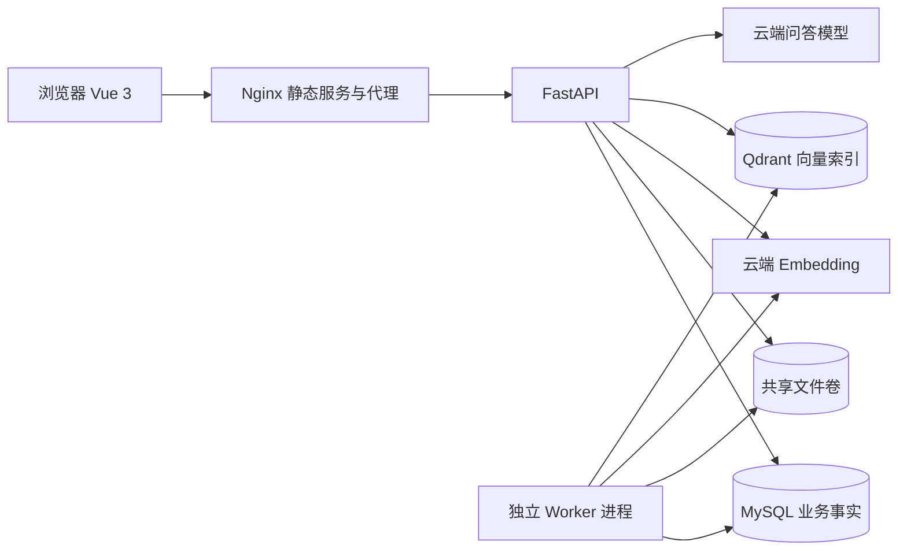
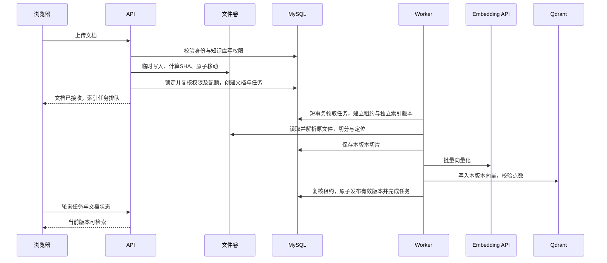
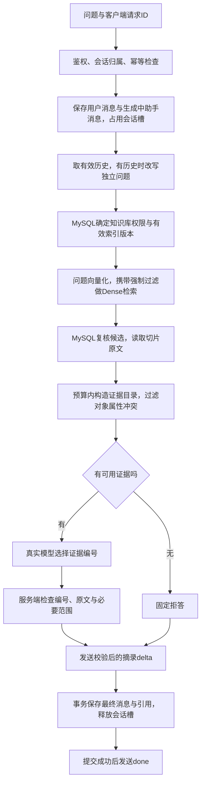
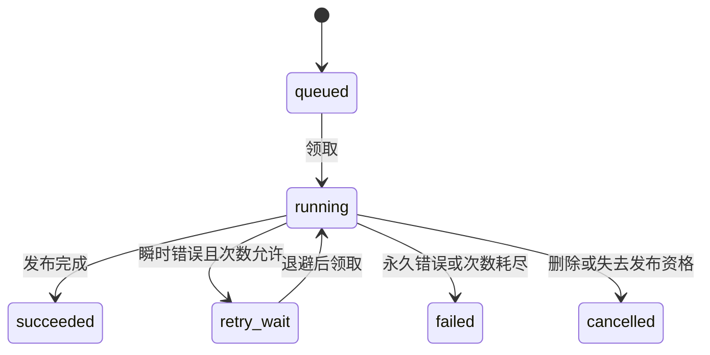
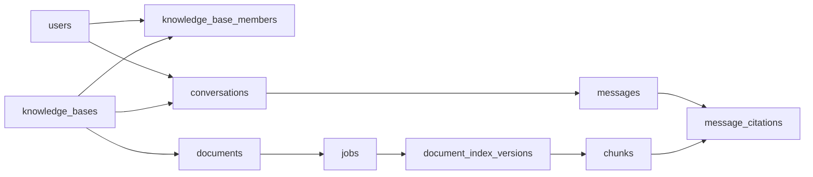

# 知识库 RAG 项目总结和常见问题分析

核对日期：2026-10-16。依据当前代码、接口契约与实际交付记录整理。阅读顺序：先看数据流与业务，再理解技术取舍，最后查看第五部分常见问题分析。

项目定位：**一个支持权限隔离、异步文档索引、多轮问答和可追溯引用的知识库系统。** 当前工程闭环与已知质量修复已实现，阶段5独立真人质量验收待完成；阶段6尚未实施。不是已经上线的大规模企业生产系统。

## 一、数据流：一份文件怎样变成一个答案？

### 1.1 先认识六个概念

| 概念 | 在本项目中是什么意思 |
| --- | --- |
| 知识库 | 一组文档与成员权限的边界，一次问答只选一个知识库 |
| Chunk（切片） | 从文章切出的可检索原文，带页码或字符位置 |
| Embedding（向量化） | 把切片和问题转换为向量，用相似度寻找相关资料 |
| 索引版本 | 文档一次索引尝试的独立产物，完整发布后才可检索 |
| 租约 | Worker在一段时间内处理任务的资格，需要定期续期 |
| SSE | 服务端向浏览器持续发送事件，本项目用来发送来源、答案片段和最终状态 |

### 1.2 总体运行结构

API与Worker共用业务代码，入口和生命周期不同。Compose部署Web、API、Worker、MySQL、Qdrant，以及一次性迁移任务；模型通过云端API调用，本机不部署模型权重。

### 1.3 文档入库流：上传成功不等于已经可检索

这里有三条关键规则：

1. 文件写入与数据库不共享事务。数据库提交失败时补偿删除本次文件；进程崩溃遗留的孤立文件由巡检处理。
2. PDF解析、Embedding和Qdrant调用在长事务之外执行，避免网络等待期间长期持有数据库锁。
3. 新索引先构建为独立版本，全部写好后才切换文档的 `active_index_version_id`。重建失败仍使用原有效版本。

普通段落按段落和列表项分开，再对长内容递归切分；简单表格可每行建立向量锚点。**向量输入可以补充列名和章节，但引用正文始终保留真实原文。**

代码入口：[文档上传](../backend/app/modules/documents/service.py#L122)、[任务领取](../backend/app/modules/indexing/service.py#L50)、[索引构建](../backend/app/modules/indexing/service.py#L209)、[发布版本](../backend/app/modules/indexing/service.py#L283)。

### 1.4 问答流：先取合法证据，再输出答案

有证据目录，也可能没有能回答问题的证据：模型可以返回空数组，再由服务端固定拒答。编号非法或来源变化则失败，不能把错误草稿标成成功。

当前模式是 `extractive-v2`：模型先输出证据编号JSON，服务端缓冲并校验，再通过SSE分段发送原文摘录。**模型上游使用真实流式API，但浏览器看到的答案不是未经校验的模型token直接透传。**

代码入口：[请求准备与会话槽](../backend/app/modules/chat/service.py#L185)、[问答执行](../backend/app/modules/chat/service.py#L381)、[原文校验与输出](../backend/app/modules/chat/evidence.py#L172)。

### 1.5 数据分别放在哪里？

| 存储 | 保存内容 | 为什么这样分 |
| --- | --- | --- |
| MySQL | 用户、成员、文档、任务、索引版本、切片正文、会话、消息、最终引用 | 保存业务事实、权限及事务状态，是是否可读和是否生效的判定来源 |
| Qdrant | 向量、知识库/文档/版本等定位与过滤字段 | 负责相似度检索，不在payload里保存完整正文，不决定授权 |
| 共享文件卷 | 上传的TXT、Markdown、文字PDF原文件 | API写入，Worker读取，支持重建索引 |
| 浏览器内存 | 登录token、界面状态和当前流式草稿 | 刷新后重新登录；成功会话历史从MySQL恢复 |
| 本地环境变量 | 数据库和模型等凭据 | 不进入Git、报告或正文日志 |

## 二、业务逻辑：系统允许什么，失败后怎么办？

### 2.1 用户、知识库和会话

用户由管理CLI创建，密码使用Argon2哈希；登录返回默认30分钟JWT。请求时检查当前用户是否启用、是否仍是知识库成员，不把JWT里的旧角色当授权依据。

| 身份 | 文档读取、来源与问答 | 上传、修改文档、重建、删除 | 知识库与成员管理 |
| --- | --- | --- | --- |
| viewer | 可以 | 不可以 | 不可以，成员列表也是owner专属 |
| editor | 可以 | 可以 | 不可以 |
| owner | 可以 | 可以 | 可以，至少保留一个有效owner |
| 实例管理员 | 仍需知识库成员身份 | 仍按知识库角色判断 | 用户生命周期管理不赋予隐含的全库读取权限 |

会话属于一个用户并绑定一个知识库。同库的其他成员不能读取别人的私人会话；知识库成员权限不等于会话所有权。

### 2.2 文档和索引任务

| 业务动作 | 关键判断 | 结果 |
| --- | --- | --- |
| 上传 | 可写角色、格式、大小及配额 | 保存原文件和排队任务；不能立即宣称索引完成 |
| 重建 | 当前没有冲突任务 | 构建新版本；失败保留旧有效版本 |
| 改标签 | 权限与任务竞争校验 | 元数据修改与新任务在同一MySQL事务提交，候选仍复核当前标签 |
| 自动重试 | 仅可重试错误且次数未耗尽 | 指数退避；默认最多3次尝试，每次独立版本 |
| 手动重试 | 失败终态 | 创建新任务并保留历史；同一失败任务最多一个直接后继 |
| 删除文档 | 可写角色 | 先逻辑删除并清空有效版本，随后异步清理文件和向量 |
| 来源读取 | 当前授权、文档未删、引用版本仍有效 | 有效才返回正文；旧引用可以显示不可用 |

任务的主要状态：

图示省略了巡检恢复和其他取消入口：过期任务在次数允许时重排；次数耗尽失败。手动重试不把原任务改回排队，而是另建后继任务。

默认保护上限包括单文件10 MiB、每库200份未删除文档和500 MiB、PDF100页、提取正文200万字符、每次索引5000块。超过上限明确失败；扫描PDF不伪造解析成功。

### 2.3 会话、并发和结束状态

| 场景 | 实际规则 |
| --- | --- |
| 同一请求重复提交 | `client_request_id`唯一约束＋事务检查，返回409及已有消息ID，不再生成一轮 |
| 同会话同时发两题 | 锁定会话行并检查 `active_message_id`，已有生成则拒绝新请求 |
| 多轮追问 | 最近最多6个成功且引用仍有效的完整轮次，按token预算继续裁剪 |
| 来源不足 | 固定拒答，不编造答案；无可用证据目录时跳过生成调用 |
| 停止或连接断开 | 取消上游调用，尽力保存cancelled状态和已有内容，释放槽 |
| 模型失败或超时 | 标记failed；失败与取消回答不进入成功历史 |
| API进程崩溃 | 到达总期限后巡检将遗留generating标记interrupted，释放槽 |
| 已落库但浏览器没收到done | 查询已有消息状态确认，不自动重放POST |

文档删除不会自动擦除以前合法生成的所有历史回答；历史正文受会话归属及当前知识库权限控制，失效引用不再返回旧来源正文，也不进入新轮历史上下文。需要彻底擦除历史时，另行设计保留和删除策略。

## 三、技术要点：不仅说用了什么，还要说为什么

| 技术或设计 | 在本项目承担什么 | 技术分析重点 |
| --- | --- | --- |
| Python3.12、FastAPI、Pydantic v2 | 异步HTTP、入参和响应契约、POST SSE | 路由薄，业务放服务层；网络调用不占长数据库事务 |
| SQLAlchemy异步、asyncmy、Alembic、MySQL | 业务持久化、短事务、锁、迁移 | READ COMMITTED；父行锁、唯一键与复合外键共同维护约束 |
| 模块化单体＋独立Worker | 共享业务规则，隔离HTTP与索引生命周期 | 保持部署和排障简单，暂不引入微服务与消息中间件 |
| MySQL任务队列 | 持久化任务、竞争领取、租约、退避 | `FOR UPDATE SKIP LOCKED`；至少一次执行，靠幂等和发布资格保证安全 |
| Qdrant Dense检索 | Cosine相似度及payload过滤 | 服务端强制知识库和有效版本范围；SQL复核后才外发正文 |
| BAAI/bge-m3 | 切片和问题向量化 | 当前真实探测1024维；批量校验数量、维度、模型和有限数值 |
| Qwen/Qwen3-8B | 追问改写和证据编号选择 | 两个职责分开，温度0.2、关闭thinking；不声称保证语义完全正确 |
| Tokenizer与预算 | 计算模型输入长度、裁剪历史和来源 | 字符不等于token；切分800字符与上下文token预算是两件事 |
| Vue3、TypeScript、Element Plus | 知识库、文档、任务和会话交互 | 请求有真实状态，失败不伪装成功 |
| fetch POST＋SSE | 带Bearer和请求体，读取事件流，支持取消 | 处理UTF-8半字、事件跨网络块、终止事件与断流 |
| Markdown安全渲染 | 展示原文摘录、表格与引用 | 禁原始HTML、限制链接协议、不加载模型远程图片 |
| Docker Compose、Nginx、健康检查 | 本机部署、同源代理、SSE禁缓冲、迁移门禁 | 就绪不代表模型供应商实时可用；不冒充HA部署 |
| pytest、Vitest及真实服务评测 | 规则、并发、权限、模型链路与前端状态验证 | 单元、真实MySQL/Qdrant集成、真实供应商live分开记录 |

这里仅用了LangChain的文本切分组件，没有采用整套LangChain链式编排，也没有自动规划与工具调用的Agent工作流。

### 3.1 重要数据关系

图中箭头表示关联，不是级联删除策略。三个尤其重要的约束是：

- `documents.active_index_version_id`：决定哪个完整版本对检索生效。
- `conversations.active_message_id`：表示该会话当前生成槽，借助行锁防止并发串话。
- `(conversation_id, client_request_id)`唯一键：防止一次请求重复创建问答。

另外，复合外键保证Chunk、版本、文档、知识库及引用不能错误拼接；授权变更共用 `authorization_guard` 单行锁，维护“至少一个有效owner”。它接受小规模写操作串行化，不能声称是可无限扩展的并发方案。

### 3.2 需要定位代码时看这里

| 主题 | 核心代码 |
| --- | --- |
| 登录、密码与JWT | [identity/service.py](../backend/app/modules/identity/service.py)、[security.py](../backend/app/core/security.py) |
| 知识库授权、最后owner | [knowledge_bases/service.py](../backend/app/modules/knowledge_bases/service.py)、[identity/service.py](../backend/app/modules/identity/service.py) |
| 文件、任务、索引与租约 | [documents/service.py](../backend/app/modules/documents/service.py)、[indexing/service.py](../backend/app/modules/indexing/service.py) |
| 检索授权与SQL复核 | [retrieval/service.py](../backend/app/modules/retrieval/service.py)、[vectors.py](../backend/app/infrastructure/vectors.py) |
| 切分与表格表示 | [parser.py](../backend/app/modules/indexing/parser.py)、[representation.py](../backend/app/modules/indexing/representation.py) |
| 证据规则与原文输出 | [constraints.py](../backend/app/modules/chat/constraints.py)、[evidence.py](../backend/app/modules/chat/evidence.py) |
| 会话幂等、监控与最终提交 | [chat/service.py](../backend/app/modules/chat/service.py) |
| 前端流解析与Markdown | [sse.ts](../frontend/src/api/sse.ts)、[markdown.ts](../frontend/src/markdown.ts) |
| 表结构、唯一键及复合外键 | [models.py](../backend/app/infrastructure/models.py) |

## 四、重难点：五个核心问题及解决方案

| 重难点 | 具体风险 | 实际方案 | 取舍或边界 |
| --- | --- | --- | --- |
| 跨存储一致性 | MySQL与Qdrant一边成功一边失败，半成品被检索 | 独立版本写入，完整后短事务原子切换指针；失败重试与后台补偿 | 没有共享事务，不宣称跨存储强一致或exactly-once |
| Worker故障恢复 | 旧进程租约过期后恢复，覆盖新进程结果 | 90秒租约、20秒续租；每次领取新token和新版本，发布时复核 | 防止迟到发布；迟到写的旧向量仍需重复清理 |
| 权限隔离 | 只在页面隐藏或召回后过滤，越权片段已发给模型 | 当前成员关系＋Qdrant强制范围＋SQL正文复核＋流中检查 | 合法发送过的内容不能追回，不承诺外部调用瞬时可撤销 |
| 问答状态一致 | 已显示答案但保存失败、重复请求产生两轮、断线状态不明 | 请求唯一键、会话行锁与生成槽；保存消息和引用后才done，断流查状态 | 无自动续传；当前摘录模式须等待选择与校验后才显示答案 |
| RAG质量定位 | 一看答错就换模型，真正的代码丢证据问题没修 | 分别看候选、证据目录、最终引用和答案；用冻结题集回归 | 规则有限、题集有限，Agent复核不能代替独立真人审核 |

两个可以讲出细节的质量案例：

- **a13，证据已找到却丢失**：标准版CSV正确表格排第1，普通表格被证据处理代码丢弃，模型答成专业版120,000行/4小时。补普通表格提取和套餐、格式约束后，纠正为标准版12,000行/18小时。
- **a18，真正漏召回**：owner导出通讯录条件的正确表格行原排第7；整表字段化只到第6；逐行向量表示后到第2，正确回答“完成二次确认后”。业务集块数42增至47，再补按原文位置去重。

图文与代码展开见[RAG优化讲解](interview-rag-optimization-guide.md)。这两个案例的原因不同，能说明自己是先定位问题再选择手段。

## 五、常见问题分析与完整解答

下面从实际实现出发分析常见问题。涉及个人分工的表述应与真实参与情况一致；项目规模、验证结果与能力边界均以已有记录为准。建议优先阅读Q1、Q2、Q6、Q7、Q10、Q17、Q19、Q20、Q21，再按关注点查看其他问题。

### Q1：请介绍一下这个项目。

> 我做的是一个带权限隔离的知识库RAG问答系统。用户可以创建知识库，上传TXT、Markdown或文字PDF，系统异步完成解析、切分和向量索引，再基于当前用户有权限的资料回答问题，并提供原文引用。后端用FastAPI，MySQL保存业务状态，Qdrant负责向量检索，前端用Vue3。我重点处理了索引任务的失败恢复、有效版本发布、问答并发和幂等，以及实际错题暴露的检索与证据处理问题。目前工程闭环已实现，独立真人质量审核仍待完成。

### Q2：从上传文件到返回答案，完整链路是什么？

> 上传时先检查知识库写权限、文件格式和配额，保存原文件，再在数据库里创建文档和索引任务。Worker领取任务后创建独立索引版本，在事务外解析、切分和向量化，写入切片与Qdrant，全部完成后原子切换有效版本。问答时先校验会话和知识库权限，有历史则补全追问，再把问题向量化，在授权有效版本内检索。候选经过MySQL复核后构成证据目录，模型选择证据编号，服务端校验并输出原文摘录。最后事务保存消息和引用，成功提交后发送done。

### Q3：为什么选择RAG，而不是直接微调模型？

> 这个项目主要解决私有资料查询、资料更新和来源追溯问题。RAG把资料放在外部知识库，资料变化时重建索引即可，不需要为了每次更新重新训练模型，也方便按用户权限检索和展示依据。微调更适合调整模型的行为或表达方式，不能直接替代文档权限、更新和引用机制。我当前没有做模型微调，优先把检索和证据闭环做可靠。

### Q4：为什么用模块化单体，没有拆微服务？

> 项目目前是单机、小规模多用户场景，拆微服务会增加部署、通信和排障成本。我按身份、知识库、文档、索引、检索、问答划分模块，路由只负责鉴权、校验和调用，业务规则放服务层，外部模型和存储放适配层。API和Worker共用代码，但运行在不同进程，索引任务不会阻塞HTTP请求。这样先保持规则一致和系统可维护，将来有明确的吞吐或团队边界再拆分。

### Q5：核心数据库表是怎么设计的？

> 我把数据分成三组：用户、知识库和成员表负责身份权限；文档、任务、索引版本和切片表负责异步索引；会话、消息和引用表负责问答。文档保存当前有效索引版本指针，会话保存当前生成消息指针，用父行锁维护并发约束。请求ID和切片序号等有唯一键，引用、切片、文档和版本之间有复合外键，防止把一个知识库的切片错误关联到另一个知识库。表结构约束负责关系正确，权限和生命周期规则仍由服务层事务判断。

### Q6：MySQL和Qdrant没有共同事务，怎么保证一致性？

> 我采用版本隔离和原子发布。每次索引尝试先创建新版本，切片和向量都写到这个版本，构建过程中不让它参与检索。全部写入并校验后，在MySQL短事务里复核租约、当前任务和文档状态，再切换有效版本指针。检索只接受MySQL指向的有效版本，因此写了一半或失败的版本不会进入答案。失败产物由后台清理，重建失败保留旧版本。这个方案是发布可见性控制加补偿恢复，不是跨存储共享事务。

### Q7：Worker处理一半宕机了怎么办？旧Worker恢复会不会覆盖新结果？

> 任务持久化在MySQL，Worker领取时拿到90秒租约，每20秒续租。进程宕机后租约过期，巡检在次数允许时重新排队。每次领取都会生成新的lease token和独立索引版本，发布时必须确认token仍匹配、租约未过期、文档未删除且任务仍是当前任务。旧Worker即使恢复并写入旧版本，也不能通过发布校验，因此不会覆盖新结果。遗留向量继续由清理任务回收，自动尝试默认最多三次，避免无限重试。

### Q8：为什么用MySQL做任务队列，不用Redis、Celery或Kafka？

> 当前任务量小，而业务状态本来就在MySQL，用数据库队列可以让上传文档和创建任务在同一事务提交，减少额外中间件。我使用FOR UPDATE SKIP LOCKED领取任务，配合租约、有限重试和幂等处理，满足当前故障恢复需求。代价是轮询、索引和锁竞争都会占用数据库资源，而且还有部分授权写操作串行化。因此我没有把它当高吞吐队列；如果压测证明队列吞吐成为瓶颈，再评估迁移并继续保留业务状态与幂等约束。

### Q9：你的幂等具体体现在哪里？

> 索引和问答各有一套约束。索引切片ID由版本和序号确定，并作为Qdrant点ID，同一版本重复upsert不会增加重复点；不同重试尝试使用新版本，防止互相覆盖。手动重试还限制同一失败任务只能有一个直接后继。问答用会话和客户端请求ID的唯一键，同一请求重复提交返回409和已有消息ID；再用会话行锁和生成槽防止同会话同时跑两轮。这样保证重复操作安全，但不宣称所有外部调用只发生一次。

### Q10：怎么保证用户不能检索到别人的文档？

> 权限由服务端决定。先校验当前用户状态、知识库成员关系和会话归属，再从MySQL取得未删除文档的有效版本，强制加入Qdrant查询过滤。客户端的文档、标签等条件只能缩小范围，不能取消这些限制。召回后还要从MySQL重新核对文档归属、有效版本和当前权限，通过后才把正文发给模型。空权限范围直接返回无上下文，不能降级成无过滤检索。来源、文件、历史消息等入口也独立鉴权，流式过程中定期复核，撤权后停止后续输出。

### Q11：登录和密码存储怎么做？为什么JWT有效也可能被拒绝？

> 用户密码只保存Argon2哈希，不保存明文；哈希计算放在线程池，不长时间占用数据库事务。登录成功签发默认30分钟JWT，前端只保存在内存，刷新后重新登录。JWT证明身份，当前用户是否启用、是否仍有知识库成员关系还要查数据库，所以token没过期也可能因为停用或撤权被拒绝。目前没有refresh token和逐个token注销机制，也没有把角色长期缓存进token来决定权限。

### Q12：怎样保证并发修改后，知识库至少还有一个owner？

> 只在修改前数一次owner不够，因为两个并发请求可能都看到另一个owner还在，然后同时把双方移除。我把成员增删、角色变更和用户停用等授权写操作放进同一锁定流程，先锁authorization_guard这一行，再锁相关知识库，重新检查当前有效owner数量后修改。这样跨库停用和成员修改也不会绕过约束。代价是部分写操作串行化，适合当前小规模场景；这类竞争用真实MySQL并发测试验证，不能靠SQLite替代结论。

### Q13：文档为什么这样切分？800和120有什么含义？

> 我先按段落和列表项分开主题，标题与紧随的首段保持在一起，再把过长内容按中文标点等递归切分。800是默认块长度的字符目标，120是目标重叠字符数，实际边界受段落和分隔符影响，不保证每块恰好重叠120。这样既避免整块混入过多主题，也减少事实被截断。字符数不等于token数，我另外用模型对应tokenizer检查输入预算，并保留页码或字符区间，让切片能回到原文核验。

### Q14：表格检索做了什么特别处理？

> 我发现整张权限表混合多个操作和角色，正确行容易被稀释。对能够完整容纳的简单表格，我为每行建立向量锚点，把目标行的列名、值和章节一起编码；引用正文仍保留表头到目标行的连续原文，不把派生文字当原话。一个owner导出条件问题的依据从第7提升到第2。代价是业务集块数42增至47、原文窗口存在重叠，所以又按文档、版本、页码和原文区间去重。目前不宣称支持所有大表和跨块表头。

### Q15：多轮问答怎么做？为什么需要Query Rewrite？

> 历史里“默认块长度和重叠呢”这种追问单独看缺少对象，所以我只在有有效历史时，把它改写成脱离历史也能检索的独立问题。改写要求保留对象、领域、动作和所有要求，也要识别用户明确换题，不能把旧答案里的数字补进问题。历史最多取最近六个成功且引用仍有效的完整轮次，再按token预算裁剪。改写成功后生成只用本轮问题和证据，减少历史事实污染；改写失败记录状态并用原问题继续受限检索。

### Q16：Embedding和向量库的模型配置怎么管理？

> 当前用云端BAAI/bge-m3，真实探测为1024维；collection按Embedding profile区分，记录模型、维度、距离度量和预处理等配置。写入时检查返回向量的数量、顺序、模型、维度和数值是否合法，检索时也核对当前服务与知识库profile一致，不能把不同空间的向量混用。配置随索引版本保存，便于重建和追溯。供应商权重修订由平台管理，因此不能保证识别同维度下所有静默模型变化，这是当前边界。

### Q17：怎么减少幻觉，为什么不用提示词就够了？

> 实测中正确资料已经召回，模型仍会把交付日期当签约日期，或把文档数量当容量，只加强提示词没有稳定解决。我改成原文证据选择模式：服务端提取句子和表格行，检查已识别的套餐、年份、角色、事件、属性与单位，模型只返回证据编号，服务端再检查编号、必要范围和原文位置，最后输出摘录及引用。缺少依据就拒答。它减少了自由编造的空间，但规则覆盖有限，来源存在也不保证回答相关，所以仍需要事实支持审核。

### Q18：为什么用POST SSE，而不是EventSource或WebSocket？

> 当前主要是浏览器提交一次问题，服务端持续返回事件，SSE满足这个方向的通信需求，不需要WebSocket的双向会话管理。我用fetch发POST，方便带JSON请求体和Bearer认证，再读取响应流。前端不能把网络分块当成完整事件，因此做了增量UTF-8解码、事件边界、多行data和终止状态校验，并用AbortController支持取消。Nginx关闭SSE代理缓冲。若将来需要持续语音等双向高频交互，再单独评估WebSocket。

### Q19：流中已经显示答案，数据库保存失败怎么办？断网又怎么办？

> 我把可见草稿和最终完成分开。当前先缓冲模型的证据选择JSON，校验后才发答案片段，再用事务保存最终消息和引用并释放会话槽，提交成功后才发done。保存失败不会标成成功；断线则取消上游调用并尽力保存取消状态，API崩溃遗留状态由超时巡检处理。如果服务端已经提交、浏览器却没收到done，前端查询已有消息状态确认，不自动重放POST。这避免把“看到了文字”误当成“已保存成功”。

### Q20：你怎么评估RAG效果？有哪些实际数字？

> 我先冻结语料、题目、预期证据位置和哈希，再运行真实Embedding、MySQL、Qdrant和问答模型。分别检查前五召回、处理后的证据目录、引用和最终答案，并记录正确拒答与误拒答。同口径原题集Recall@5从12/22，也就是54.5%，提高到最新21/22，即95.45%。五篇含干扰项的业务集，证据召回从34/35到35/35，Agent逐题评审从32/36到36/36。后者不是独立真人评分，修复后题集也已成为回归集，不能据此宣称真实业务准确率100%。

### Q21：讲一个你实际定位和修复的问题。

> 有一道题问标准版CSV导出上限，应该是12,000行、18小时，实际却答了专业版120,000行、4小时。我先看检索候选，发现正确表格已经排第1，所以继续追踪处理后的证据目录，定位到旧代码只支持权限表，普通表格被丢弃。修复时统一解析表头和行，把列名与本行绑定，再增加套餐、年份和CSV/PDF冲突检查。回归后能正确摘录标准版行。这个问题让我明确，召回正确也可能在后处理丢失证据，不能看到误答就直接换模型。

### Q22：测试怎么分层？真实模型和测试替身怎么区分？

> 单元测试验证规则的正反例，例如日期与地点不能混用、表格列和值绑定、原文去重和非法引用。集成测试用真实MySQL和Qdrant，覆盖锁竞争、租约恢复、版本发布、删除和权限隔离，不用SQLite替代这些结论。live测试才调用真实Embedding和聊天供应商，验证模型链路。测试替身只用于可控故障和规则测试，不作为运行时回退。已有交付记录是后端175项通过，前端18项行为测试及类型检查、构建通过；独立人工事实审核仍是另一项工作。

### Q23：性能和成本上做了什么？如果量增大怎么改？

> 当前先做有上限的资源控制：Embedding批量调用且限制并发，检索默认Top5，历史和来源按token预算裁剪，索引有文件、页数和块数上限。数据库只在领取、更新进度和发布时用短事务，网络请求放在事务外。代价也如实记录，例如逐行索引增加块数，追问改写增加模型调用，摘录校验增加首次展示前的等待。我没有高并发压测或线上QPS数据；量增大后先测队列积压、数据库锁竞争和模型延迟，再决定扩大Worker、迁移队列或引入缓存。

### Q24：文档安全和提示注入怎么处理？

> 上传侧检查格式、大小、页数和提取上限，用服务端生成的内部路径保存文件，PDF解析在受限子进程中运行。问答侧把用户问题和文档正文当成数据，模型没有工具执行或跨库读取权限，文档里的指令不能改变服务端授权范围。前端Markdown关闭原始HTML、限制链接协议并禁止加载模型远程图片。模型凭据来自环境变量，日志不记录正文和密钥。这些措施缩小了攻击面，但不把提示词或JSON输出当成解决所有提示注入的保证。

### Q25：文档重建、删除以后，旧索引和历史引用怎么办？

> 重建时先在新版本完成索引，成功发布才替换旧有效版本，失败继续使用旧版。删除时先在MySQL逻辑删除、清空有效版本并撤销发布资格，向量和文件稍后清理；即使物理残留，检索也不再接受它。历史引用读取会重新检查当前版本，失效时标记不可用，也不把相关旧轮次放进新问题上下文。历史回答属于曾经合法生成的业务记录，目前不会因删文档自动全部擦除；彻底擦除需要另外定义保留策略。

### Q26：项目还有哪些没做？下一步是什么？

> 当前已实现单知识库Dense检索、多轮追问改写、表格表示和证据摘录校验，但阶段5独立真人正确性与事实支持审核尚未完成。Multi-query、Hybrid和Rerank属于后续评估，没有默认启用；OCR、DOCX、文档级权限、SSO和高可用也没有实现。下一步先完成独立质量审核和新增留出集验证，再针对剩余错题做对照实验。如果主要问题仍是证据排位，再评估Hybrid或Rerank，并同时比较质量、延迟、调用成本与权限边界。

## 五条核心总结

1. **数据流**：上传 → 异步索引 → 发布有效版本 → 权限内检索 → 选择证据 → 校验摘录 → 提交后done。
2. **业务逻辑**：知识库角色决定文档操作，会话只归本人；上传、可检索和任务成功是不同状态。
3. **技术要点**：模块化单体、短事务、租约与版本、服务端权限过滤、POST SSE、原文可追溯。
4. **重难点**：跨存储发布、迟到Worker、越权外发、问答幂等与结束状态、分层质量诊断。
5. **结果边界**：同口径Recall@5为54.5%→95.45%；业务回归Agent评审32/36→36/36；独立真人审核待完成。

依据：[架构](architecture.md)、[数据模型](data-model.md)、[接口契约](api-contract.md)、[最新业务修复交付与检查记录](stage-5-business-fix-delivery.md)、[机读结果](../evaluation/stage5-business-fix-results.json)。本次仅编写总结和常见问题分析文档，没有重新运行上述测试或云端评测。
